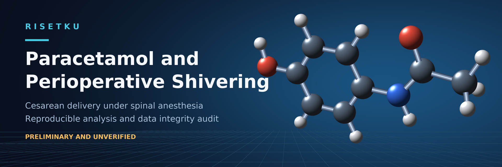
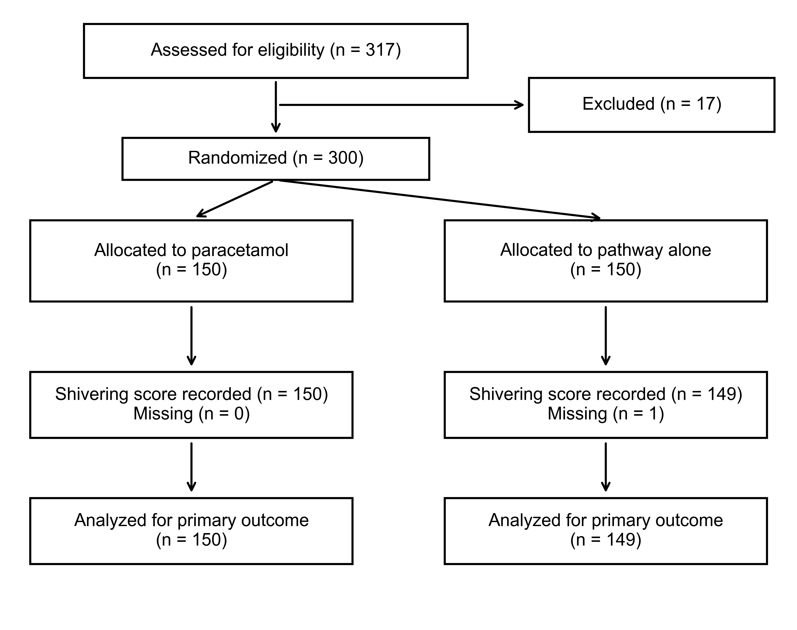
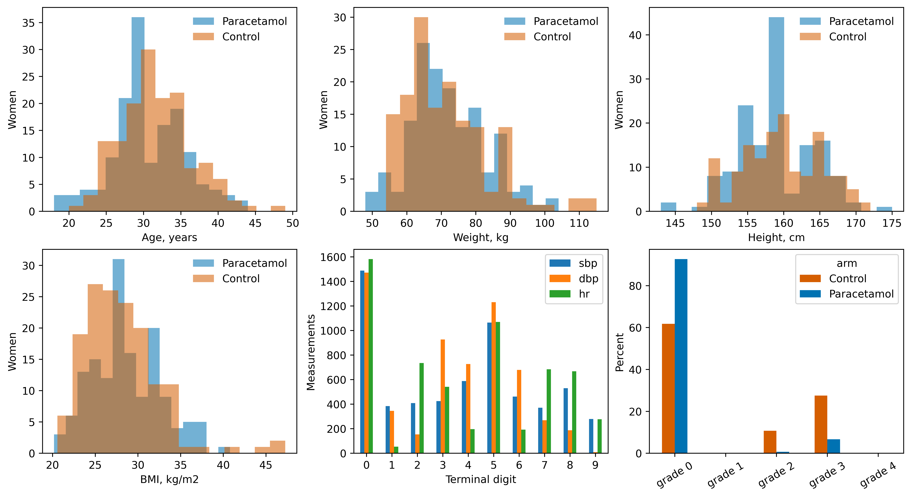

<p align="center"></p>

<p align="center">
<a href="https://colab.research.google.com/github/sharing-123/risetku-paracetamol-shivering/blob/main/notebooks/Risetku_ParacetamolAnalysis.ipynb"></a>
</p>

> **Status.** Preliminary, unverified and not peer reviewed. These results do not establish efficacy or safety and must not be used for clinical decisions.

## Overview

Prepared by Risetku. Reproducible analysis of an open-label randomized comparison of intravenous paracetamol for shivering during cesarean delivery under spinal anesthesia. The pipeline imports the spreadsheet, removes names at import, logs every cleaning step, screens data integrity, runs the descriptive and inferential analyses and exports the tables and figures.

## Data integrity

Of 300 women, 252 share an identical 20-point series of systolic pressure, diastolic pressure or heart rate with another woman. Autoregressive simulations produce none. The origin has not been established, so hemodynamic estimates are not reported.

The aggregate screening results are in [integrity_series.csv](results/tables/integrity_series.csv) and [integrity_null_models.csv](results/tables/integrity_null_models.csv).

## Primary outcome as recorded

The shivering assessor knew the allocation.

| Analysis | Paracetamol | Control | Risk ratio (95% CI) |
|---|---|---|---|
| Primary: all recorded women with an outcome | 11/150 (7.3%; 4.1 to 12.7) | 57/149 (38.3%; 30.8 to 46.3) | 0.19 (0.10 to 0.35) |
| Missing outcome counted as no shivering | 11/150 (7.3%; 4.1 to 12.7) | 57/150 (38.0%; 30.6 to 46.0) | 0.19 (0.11 to 0.35) |
| Missing outcome counted as shivering | 11/150 (7.3%; 4.1 to 12.7) | 58/150 (38.7%; 31.2 to 46.7) | 0.19 (0.10 to 0.35) |
| Excluding women not meeting eligibility criteria | 10/127 (7.9%; 4.3 to 13.9) | 49/133 (36.8%; 29.1 to 45.3) | 0.21 (0.11 to 0.40) |
| Also excluding fetal distress or PTM notes (post hoc) | 10/125 (8.0%; 4.4 to 14.1) | 45/127 (35.4%; 27.7 to 44.1) | 0.23 (0.12 to 0.43) |

<p align="center"></p>
<p align="center"></p>

## Exploratory data analysis



Subgroup and Bayesian outputs in the notebook are exploratory and are not results reported in the manuscript. Participant level and hemodynamic outputs are withheld.

## Structure

| Path | Content |
|---|---|
| `notebooks/` | Executed notebook |
| `src/` | Notebook source, notebook builder and 3D asset builder |
| `results/tables/` | Aggregate tables |
| `results/figures/` | Figures |
| `assets/` | Banner and a [3D model of paracetamol](assets/paracetamol.stl) that GitHub can rotate |

## Running

Patient data are not stored here. In Colab, run the notebook and upload `data parasetamol jurnal.xlsx` when asked. Locally, place the file in `source/` and run

```bash
pip install -r requirements.txt
python src/build_notebook.py --run
```

The notebook records two author-reported corrections, 1113 to 113 and 1114 to 114 mmHg, which still require confirmation against source charts. Integrity screening always uses the uncorrected values.
