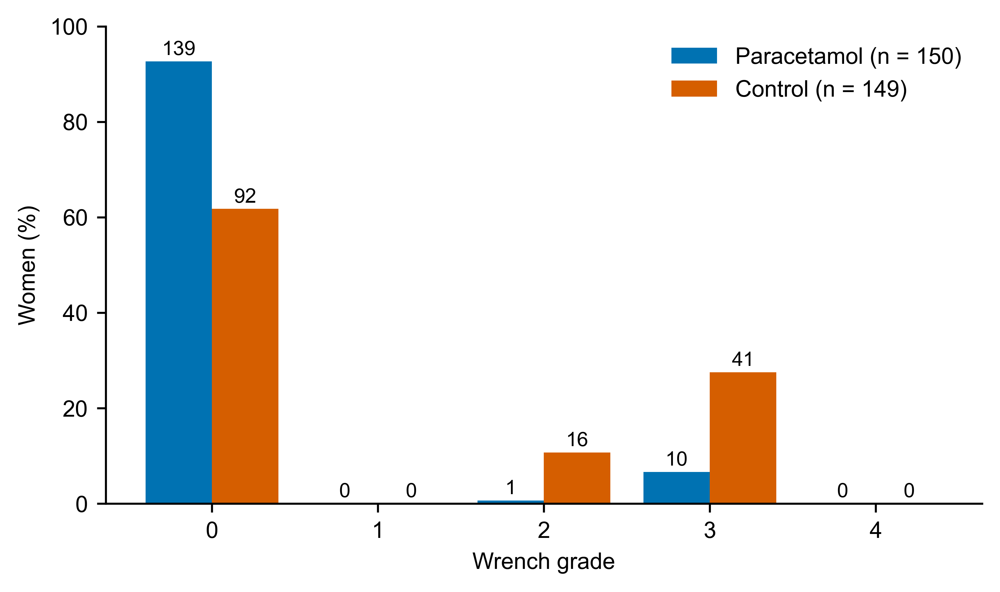

<p align="center">
  
</p>

<p align="center">
  
  
  
  
  <a href="https://colab.research.google.com/github/sharing-123/risetku-erac/blob/main/erac.ipynb"></a>
</p>

# Paracetamol and Shivering

<p align="center"><em>Intravenous Paracetamol Before Spinal Anesthesia for Shivering in Elective Cesarean Delivery Within an Enhanced Recovery Pathway. An Open-Label Randomized Controlled Trial</em></p>

<p align="center"><strong>Risetku</strong><br>Reproducible analysis and data integrity screening</p>

> [!WARNING]
> These results are preliminary, unverified and not peer reviewed. They do not establish efficacy or safety and must not be used for clinical decisions.

## Abstract

Background and objectives. Shivering is common during cesarean delivery under neuraxial anesthesia and can disturb monitoring, comfort and early contact between mother and infant. We examined shivering after prophylactic intravenous paracetamol within an enhanced recovery pathway without routine active warming.

Methods. In this single-center, open-label, parallel-group trial, women scheduled for elective cesarean delivery under spinal anesthesia were randomized 1:1 to paracetamol 1 g before spinal anesthesia plus the institutional pathway, or to the pathway alone. The shivering assessor knew the allocation. The primary outcome was a highest recorded Wrench grade of 1 or more. Integrity screening of the dataset was added at revision. Registration was retrospective.

Results. Of 300 women, 299 had a shivering score. Shivering was recorded in 11 of 150 (7.3%) with paracetamol and 57 of 149 (38.3%) in controls (risk ratio 0.19, 95% CI 0.10 to 0.35). Grades 1 and 4 never appeared. Of 300 women, 252 shared an identical series of systolic pressure, diastolic pressure or heart rate with another woman, far beyond autoregressive simulation. Hemodynamic outcomes were therefore not analyzed.

Conclusions. Shivering was recorded less often with paracetamol. Unblinded assessment and unexplained repetition in the hemodynamic records mean that this difference does not establish efficacy or safety. Independent source verification and a blinded, prospectively registered trial are needed.

Keywords. Cesarean section, Spinal anesthesia, Shivering, Acetaminophen, Enhanced recovery after surgery

<p align="center">
  
</p>
<p align="center"><sub><em>Figure 1. Participant flow. The numbers assessed and excluded come from the earlier report and await confirmation against the screening log.</em></sub></p>

## Methods

| Stage | Content |
|---|---|
| Import | Names are removed as the spreadsheet is read |
| Cleaning | Decimal commas, implausible values and every change are logged |
| Corrections | Systolic 1113 and 1114 treated as 113 and 114 mmHg on author advice, pending source confirmation |
| Integrity | Identical series, autoregressive and block resampling simulations, outcome coding and eligibility screening |
| Description | Baseline table with standardized mean differences |
| Primary analysis | Risk ratio, risk difference, number needed to treat, odds ratio and missing outcome scenarios |
| Robustness | Modified Poisson regression, eligibility sensitivity analyses, exploratory Bayesian and subgroup analyses |

## Results

### Data integrity

| Measure among 300 women | Systolic | Diastolic | Heart rate |
|---|---|---|---|
| Sharing an identical 20-point series | 186 | 99 | 120 |
| Largest identical group | 13 | 49 | 54 |
| Series present in both groups | 35 | 4 | 8 |
| Maximum in 500 autoregressive simulations | 0 | 0 | 0 |

The origin of the repetition has not been established. Full simulation results are in [integrity_null_models.csv](results/tables/integrity_null_models.csv).

### Shivering as recorded

The assessor knew the allocation.

| Outcome | Paracetamol | Control | Risk ratio (95% CI) |
|---|---|---|---|
| Any shivering | 11/150 (7.3%) | 57/149 (38.3%) | 0.19 (0.10 to 0.35) |
| Grade 3 or 4 | 10/150 (6.7%) | 41/149 (27.5%) | 0.24 (0.13 to 0.47) |
| Any shivering, eligibility flags excluded | 10/127 (7.9%) | 49/133 (36.8%) | 0.21 (0.11 to 0.40) |

<p align="center">
  
</p>
<p align="center"><sub><em>Figure 2. Highest recorded Wrench grade by group. Numbers above bars are counts.</em></sub></p>

<p align="center">
  
</p>
<p align="center"><sub><em>Figure 3. Distributions of age, anthropometry, terminal digits and recorded grades.</em></sub></p>

## Limitations

Outcome assessment was unblinded and no placebo was used. Registration was retrospective. Some women did not meet eligibility criteria. The hemodynamic records failed integrity screening and no independent source verification has been performed. Participant level and hemodynamic outputs are withheld from this repository.

## Software and reproducibility

Patient data are not stored here. In Colab, choose Run all and upload `data parasetamol jurnal.xlsx` when asked. Locally, place the file in `source/` and run

```bash
pip install -r requirements.txt
python src/build_notebook.py --run
```

The banner and the [3D model of paracetamol](assets/paracetamol.stl), which GitHub can rotate in the browser, are generated by

```bash
python src/build_assets.py
```

| Path | Content |
|---|---|
| `erac.ipynb` | Executed notebook |
| `src/` | Notebook source, notebook builder and asset builder |
| `results/tables/` | Aggregate tables |
| `results/figures/` | Figures |
| `assets/` | Animated banner and 3D model |

Subgroup and Bayesian outputs are exploratory and are not results reported in the manuscript.

## Data and licensing

The dataset is not publicly available because of privacy and ethical restrictions. No reuse license has been granted.

## References

1. Hopewell, S.; et al. CONSORT 2025 statement. Lancet 2025, 405, 1633–1640. https://doi.org/10.1016/S0140-6736(25)00672-5
2. Liu, J.; et al. Efficacy of intravenous acetaminophen on postoperative shivering. Medicine 2024, 103, e38710. https://doi.org/10.1097/MD.0000000000038710
3. Ferrea, G.; et al. Comparative efficacy of intravenous treatments for perioperative shivering in caesarean delivery. J. Clin. Anesth. 2025, 100, 111680. https://doi.org/10.1016/j.jclinane.2024.111680
